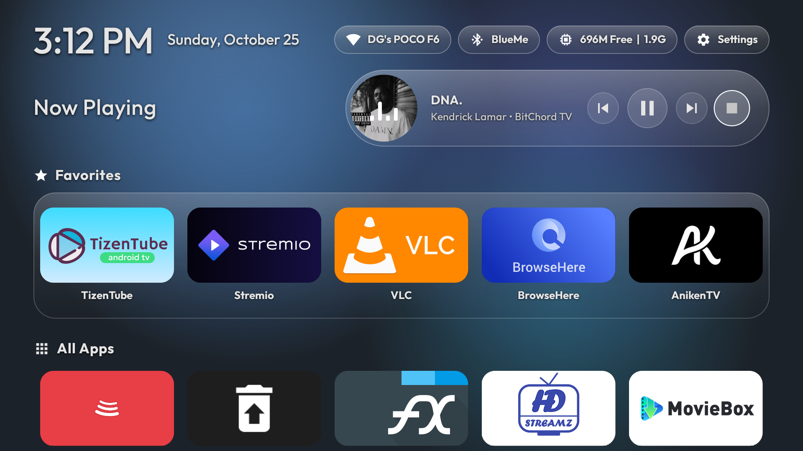
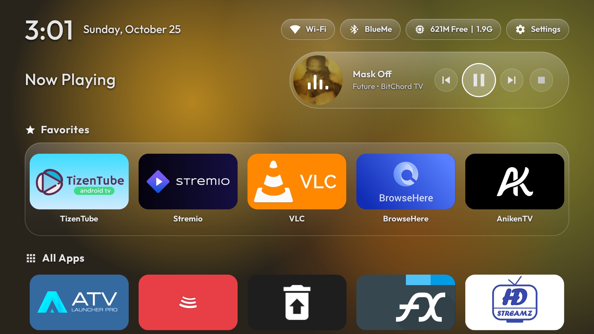
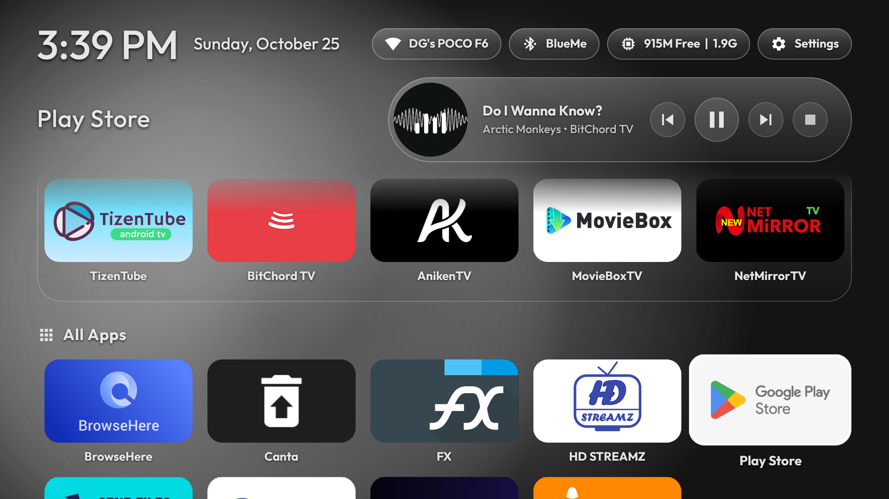
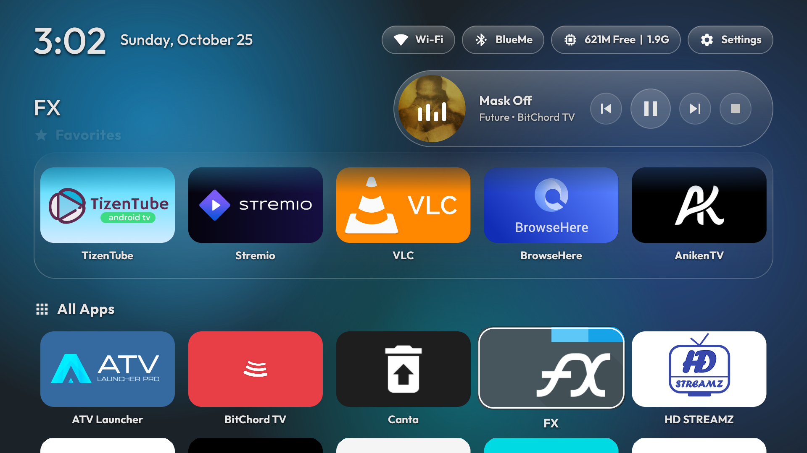
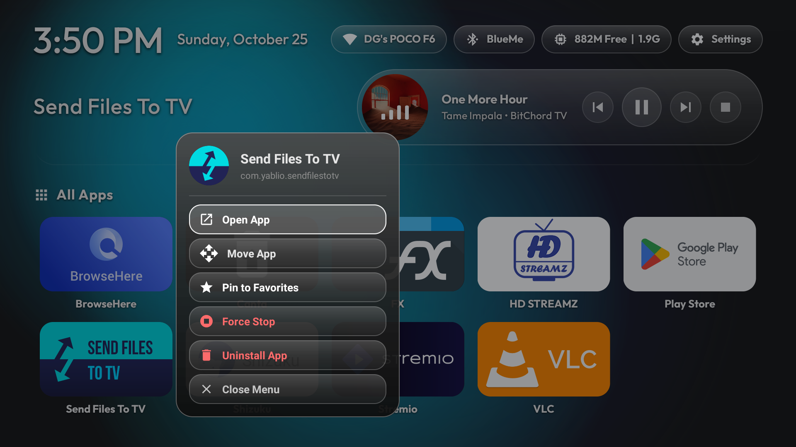
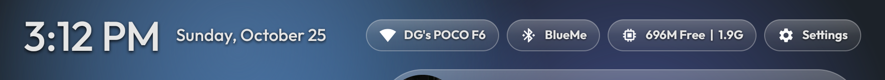
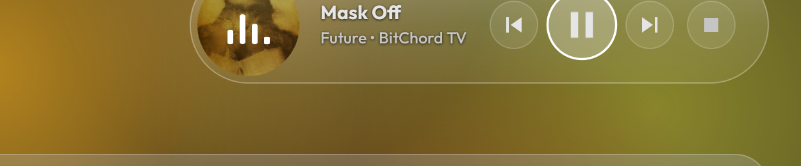
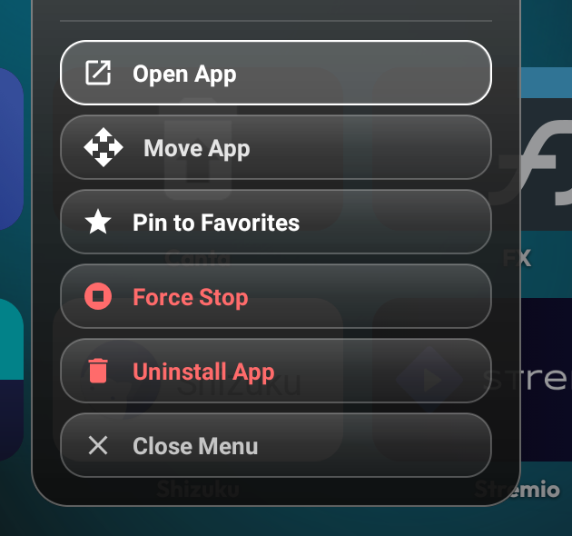
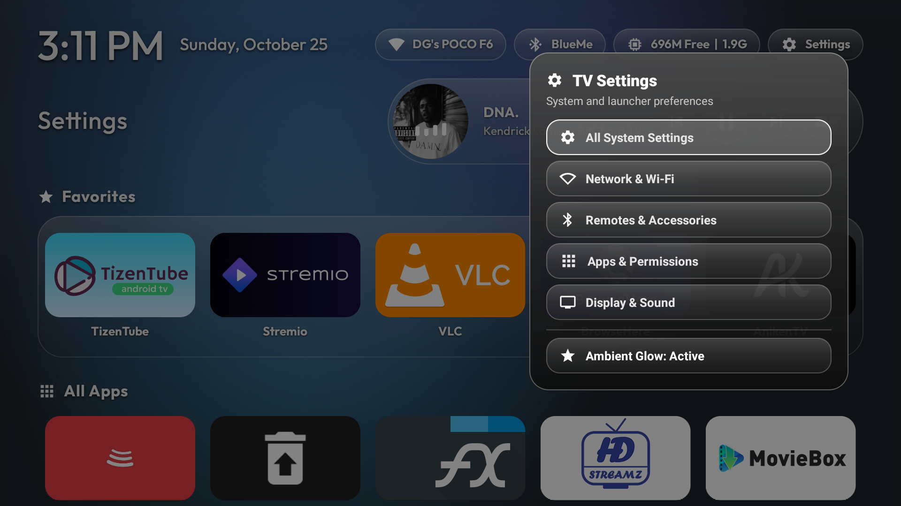
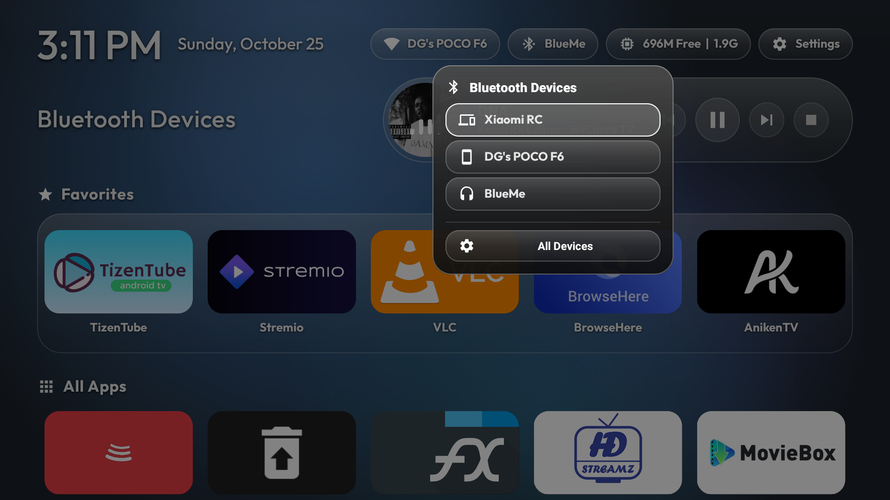

# System Launcher NoBloat ⚡

[](https://github.com/darshan-gowdaa/NoBloat-MiBox4K-TV-Launcher/releases)
[](https://github.com/darshan-gowdaa/NoBloat-MiBox4K-TV-Launcher/releases)
[](#)
[](#)

> **Inspiration**: This project was inspired by [Gathin23/cleanyourtv](https://github.com/Gathin23/cleanyourtv). Re-engineered from the ground up in pure native Android Java & AAPT2 with zero external dependencies, zero bloat, an ultra-compact **176 KB** APK size, and hardware-accelerated 60 FPS animations.

---

## ✨ Features

- **⚡ Ultra-Lightweight & Blazing Fast**: Consumes less than 15 MB RAM (compared to 180+ MB on stock Android TV Leanback Launcher). Entire app binary is only **176 KB** with zero dependencies.
- **🌌 Living Ambient Gradient Mesh**: Continuous, non-repeating multi-orb ambient lighting running at 60 FPS. Automatically samples major colors directly from active media artwork and focused apps.
  - **Neutral Monochrome Mode**: For black & white album covers (e.g. Arctic Monkeys, Future & Metro Boomin) or monochrome icons, ambient glow uses natural frosted silver and obsidian slate with **zero artificial blue injection**.
- **🎵 Smart Now Playing Media Capsule**: Seamlessly connects to active media sessions (Spotify, YouTube, BitChord, VLC, etc.) with real-time album artwork, live animated audio equalizer, track marquee, and media playback controls.
- **⭐ Zero-Rule Dynamic Favorites Dock**:
  - **No Minimum Rule**: Can be 0 apps—when empty, the entire Favorites section and dock shelf automatically hide for an ultra-clean home screen.
  - **No Maximum Rule**: Supports 1, 2, 5, 8+ apps with seamless multi-row wrapping and fluid D-Pad navigation.
- **📱 All Apps Grid with Custom Reordering**: Move and organize app positions in All Apps with D-Pad. Custom order is automatically saved and persisted across reboots.
- **🎛️ Refined Quick Menu Modal**:
  - Long-press any app in Favorites or All Apps.
  - Crisp **circular app icon frame**.
  - Instant actions: **Open App**, **Move App**, **Pin / Remove Favorites**, **Force Stop**, and **Uninstall App**.
- **📶 Smart Dynamic Wi-Fi Indicator**: Real-time signal-level filled Wi-Fi icons (0 to 4 bars) with live SSID network name detection (`DG's POCO F6`), auto-refreshing on network changes.
- **🕒 12-Hour Clock with AM/PM**: High-visibility typography powered by Outfit Medium font.
- **↕️ Seamless Living Ambient Header Scrim**: Pinned header with an integrated atmospheric gradient mask that lets app tiles slide underneath smoothly on scroll without hard cutoffs or black bars.
- **🔄 Auto-Refresh on Install/Uninstall**: Automatically refreshes app grids when applications are installed, removed, or updated via background broadcast receivers with zero memory leaks.
- **🎛️ Quick Control Modals**: Access paired Bluetooth devices and quick system settings directly from the top bar with trapped D-PAD navigation.

---

## 📸 Feature Showcase

### 1. Clean Home & Living Ambient Lighting
*Minimal glass dock shelf, dynamic filled Wi-Fi pill with live network name, real-time memory stats, and living ambient lighting.*


---

### 2. Smart Now Playing Media Capsule
*Real-time media session tracking with extracted album cover dominant colors, live animated equalizer, and synced ambient background glow.*


---

### 3. Natural Monochrome Ambient (Zero Blue for B&W Art)
*For black and white covers (e.g. Arctic Monkeys, Future & Metro Boomin), the ambient engine produces a gorgeous, frosted silver and obsidian glow without any artificial blue hues.*


---

### 4. Seamless Living Ambient Scrolled Header
*App tiles slide smoothly underneath the living ambient header with soft bottom gradient fade and zero visual seams.*


---

### 5. Quick App Menu Modal (Circular Icon & Reordering)
*Clean white frosted glass modal on long-press with circular app icon and options to Move, Pin/Unpin, Force Stop, or Uninstall.*


---

### 6. Component Highlights

| Top Status Bar (Clock AM/PM, Wi-Fi SSID, Bluetooth, RAM, Settings) | Now Playing Player Capsule with Live Equalizer |
|:---:|:---:|
|  |  |

| Quick Menu Card with Circular Icon | Quick TV Settings Modal |
|:---:|:---:|
|  |  |

---

### 7. Quick Bluetooth Device Switcher
*Instant connection to paired Bluetooth gamepads, remotes, headphones, and speakers.*


---

## 🚀 Setting Up & Installation Guide

### Prerequisites
- Android TV device (e.g. Xiaomi Mi Box 4K, Chromecast with Google TV, Nvidia Shield, Fire TV) running Android 8.0+ (API 26+).
- Computer with `adb` (Android Debug Bridge) installed.
- TV and computer connected to the same Wi-Fi network.

### Step 1: Enable Developer Options & USB Debugging on TV
1. On your Android TV, navigate to **Settings** > **Device Preferences** > **About**.
2. Scroll down to **Build** and press the **Select / OK** button 7 times until you see `"You are now a developer!"`.
3. Go back to **Device Preferences** > **Developer options** and turn on **USB debugging**.

### Step 2: Connect via ADB & Install APK
Download the latest `System-Launcher-NoBloat-v1.0.0.apk` from the [Releases tab](https://github.com/darshan-gowdaa/NoBloat-MiBox4K-TV-Launcher/releases).

```bash
# Connect to your TV's IP address (found in Settings > Network & Internet > Wi-Fi)
adb connect <YOUR_TV_IP>:5555

# Install the launcher
adb install -r System-Launcher-NoBloat-v1.0.0.apk
```

### Step 3: Grant Required Permissions
To enable the **Now Playing** media capsule, dynamic **Wi-Fi SSID** display, and hardware key shortcuts, run:

```bash
# 1. Enable Notification Listener Service for Now Playing media controls
adb shell cmd notification allow_listener com.nobloat.launcher/com.nobloat.launcher.media.MediaNotificationListener
adb shell settings put secure enabled_notification_listeners com.google.android.tvrecommendations/com.google.android.tvrecommendations.NotificationsService:com.nobloat.launcher/com.nobloat.launcher.media.MediaNotificationListener

# 2. Grant Location Permissions for Wi-Fi SSID network name display
adb shell pm grant com.nobloat.launcher android.permission.ACCESS_FINE_LOCATION
adb shell pm grant com.nobloat.launcher android.permission.ACCESS_COARSE_LOCATION

# 3. Grant Accessibility Service for remote home button key interceptor (optional)
adb shell settings put secure enabled_accessibility_services com.nobloat.launcher/com.nobloat.launcher.KeyInterceptorService
```

### Step 4: Set as Default Launcher
Press the **HOME** button on your remote control and select **System Launcher NoBloat**, then choose **"Always"**.

#### Optional: Disable Stock Bloatware Launcher
To prevent the stock Google TV / Mi Box launcher from running in the background and serving ads:

```bash
# Disable stock Google TV launcher
adb shell pm disable-user --user 0 com.google.android.tvlauncher

# (Optional) Disable Xiaomi PatchWall / Mi TV recommendations if present
adb shell pm disable-user --user 0 com.mitv.tvhome
```

#### How to Re-enable Stock Launcher Anytime
```bash
adb shell pm enable com.google.android.tvlauncher
```

---

## 🛠️ Building from Source

This project does not rely on heavy Gradle dependencies. It compiles cleanly in under 5 seconds using a lightweight Python build script leveraging `aapt2`, `javac`, and `d8`.

### Requirements
- Android SDK with `build-tools/34.0.0`
- JDK 17+
- Python 3.8+

### Build Command
```bash
python build_launcher.py
```
Output APK will be generated and signed at `release/System-Launcher-NoBloat-v1.0.0.apk`.

---

## 📄 License

Licensed under the Apache License, Version 2.0. See LICENSE for details.
